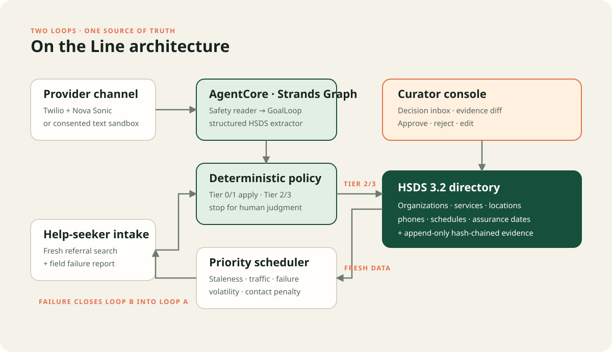

# On the Line

🥈 **2nd place, Good Neighbor Agents track, AWS *Agents for Humans* Hackathon.**

**When a meal is on the line, someone should be on the line.**

On the Line is a community resource directory that phones ahead. It calls the food banks, clinics
and shelters it lists, confirms what is still true, publishes only what a provider said out loud
and confirmed on readback, and hands everything that needs judgment to a person. When a neighbour
reports a closed door, that report becomes the next call in the same database transaction.

Built for the AWS *Agents for Humans* hackathon, Good Neighbor Agents track.

## Try it

**<https://54-84-108-211.sslip.io>**

The public side needs no account: <https://54-84-108-211.sslip.io/help> is the search a person
looking for help would use. Sign in to the curator console with `judge` / `ontheline-demo-2026`.

- `/help` — search, take a referral, and report a closed door. Watch that report reach the top of
  the call queue.
- Overview — press **Call the provider** on the first queued service and listen to the call. Turn
  the sound on.
- Decisions — the closure the agent refused to publish, with the evidence diff and the quote.
- Activity — the append-only chain, which the database will not let anyone edit or delete.
- Add `?demo=1` to any page for a narrated walkthrough that drives the real console. Escape stops it
  and hands the product back.

The directory is a clearly labelled demonstration dataset and restores itself every six hours.

## The problem, in one trip

Two buses. Two children. A pantry that closed in July and a directory that still says Wednesdays,
nine to twelve. The referral was free to send and expensive to follow.

[United Way reports](https://www.unitedway.org/sites/default/files/2026-03/260310_MC_211%201%20Pager%20General-Accessible.pdf)
that the US 211 network made **19 million referrals** across **1.6 million locally curated services
and programs** in 2025. [Open Referral documents](https://openreferral.org/about/strategic-overview/)
the maintenance loop behind that number: fragmented directories repeatedly ask the same service
providers for the same updates, staff spend their time re-verifying records, and the people relying
on the listing get less reliable information.

## One call, three neighbours

The same phone call helps three different people, which is what makes this a Good Neighbor project
rather than a data-quality tool.

| Who | What they get |
|---|---|
| The person looking for help | A listing a human being confirmed, with the date they said it |
| The volunteer holding the directory together | The routine calls made without them; only judgment reaches their inbox |
| The organization being listed | Called once instead of twelve times, because the answer is published as open HSDS that any other directory can consume |

## The mechanic

Someone finds the door locked and says so. On the Line promotes that service to priority 1000 and
calls the provider. The next neighbour finds it open. Help-seekers become the freshness sensors;
the provider calls are the repair crew.

## Run the complete local product

Python 3.12 or newer is required.

```powershell
uv sync --extra dev --extra eval
.\.venv\Scripts\ontheline serve
```

Or without `uv`:

```powershell
python -m venv .venv
.\.venv\Scripts\Activate.ps1
pip install -e ".[dev,eval]"
ontheline serve
```

Open <http://localhost:8000> and sign in with `judge` / `ontheline-demo-2026`. The public,
credential-free seeker experience is available at <http://localhost:8000/help>.

The development dataset opens with a completed autonomous change, a closure waiting for human
judgment, an active verification queue, provider-consent controls, and a public intake flow. The
provider sandbox exercises the same policy and database transactions as live calls.

Container startup is equally direct:

```bash
docker compose up --build
```

## Product capabilities

- Curator console: campaign dashboard, ranked queue, decision inbox, directory browser, provider
  consent intake, evidence diff, and append-only activity trail.
- Open Referral HSDS 3.2: validated import, normalized storage, stable UUID export, public collection
  endpoint, service endpoint, and profile metadata.
- Closed-loop intake: active-service search, referral receipts, failure reports, PII redaction, and
  atomic promotion of failed services to priority 1000.
- Verification call: the console places the call, streams the transcript turn by turn as it is
  spoken, marks the readback, and shows the tier the policy reached. On a configured deployment
  the same surface dials over Twilio; without one it runs on the pilot line and the extractor,
  tier policy, write path and audit trail are identical either way.
- Dual voice channels: consent-gated outbound provider verification and inbound help-seeker intake
  over authenticated Twilio Media Streams and Amazon Nova 2 Sonic.
- Production extraction: an Amazon Nova 2 Lite Strands Graph with a safety reader, structured HSDS
  extractor, GoalLoop domain validation, lifecycle hooks, and persisted graph sessions.
- Deterministic reconciliation: model output is a proposal; plain Python policy and transactional
  database code alone decide whether a field may be published.
- Durable human judgment: pending changes and safety flags survive process restarts and are resolved
  by approve, edit, reject, or acknowledge transactions in the curator console.
- Consent-aware scheduling: IANA-timezone business windows, allowed weekdays, validity periods, call
  caps, organization-level spacing, atomic task claims, and persisted exponential retry times.
- Security: scrypt password hashes, opaque server sessions, CSRF, login throttling, trusted hosts,
  HTTPS enforcement, CSP/security headers, bounded bodies/media frames, signed Twilio callbacks,
  one-time media tokens, and non-root containers.
- Evidence integrity: every automatic change and human decision retains the call, timestamp, quote,
  consent reference, policy tier, and agent trace in a SHA-256 hash chain protected by database
  triggers against update and deletion.

## The escalation policy

| Tier | Evidence | Transaction |
|---|---|---|
| 0 | Every requested field explicitly confirmed unchanged | Refresh assurance date |
| 1 | Allowlisted field, high confidence, canonical value, explicit statement and confirmed readback | Apply with evidence |
| 2 | Removal, eligibility, ambiguity, contradiction, partial verification, or low confidence | Persist in decision inbox |
| 3 | Missing AI disclosure, distress, help-seeker reached, hostility, or stop request | End, flag, and suppress when requested |

Changes are atomic at the verification level. If one requested field needs judgment, no other
proposed change from that call is silently applied. A model cannot reach a publish, delete, or SQL
tool.

## The verification call

`ontheline.workflow.CALL_SCRIPTS` holds the call for each provider response. `tools/build_call_audio.py`
renders every turn with a separate voice per speaker, filtered to the 300-3400 Hz telephone band, and
writes `src/ontheline/web/call/` plus a manifest carrying each clip's measured duration. The console
reveals each transcript line exactly when it is spoken, so the words on screen and the words in the
audio cannot drift.

The call is not a script the model is asked to agree with. It is the input: the safety reader and
the extractor see the transcript, and the policy in `ontheline.policy` decides what may be written.
A readback that is missing, hedged, or contradicted lands in the decision inbox rather than the
directory.

That holds for a live provider call too, and it takes two things rather than one. The voice agent
records what it heard through its tools, including whether the provider confirmed a readback, and
the tier policy treats that flag as evidence. It is produced by the model that ran the
conversation, so it is checked before policy sees it: `ontheline.readback` looks in the transcript
for the exchange the flag claims happened, which is the provider raising the value, the assistant
reading the whole of it back, and the provider agreeing, in that order. No model is involved, so
the check runs on every call in every mode. Where a model path is configured, the finished
transcript is then read by the extraction graph as well, and the two readings have to agree on a
field and its value before it publishes. A disagreement goes to a curator with the reason recorded
on the run.

One consequence is worth stating plainly rather than hiding: the stored transcript redacts phone
numbers, so a phone readback cannot be corroborated from the record, and a phone change heard on a
live call always goes to a person.

```powershell
python tools/build_call_audio.py    # regenerate the audio after editing a call
```

## Architecture



The two product loops share one canonical directory and one evidence chain:

1. The scheduler ranks fields using staleness, volatility, referral volume, first-hand failures,
   seasonality, and a recent-contact penalty.
2. The provider voice agent or Strands extraction graph produces schema-valid evidence.
3. Tier 0/1 results commit transactionally; Tier 2/3 results persist for a curator.
4. Web and voice intake search active, freshness-ranked services and create referral receipts.
5. A reported field failure promotes the matching verification task in the same transaction.

The application can invoke extraction directly through Bedrock or through the supplied stateless
Amazon Bedrock AgentCore runtime. Policy, consent, HSDS data, and human decisions remain in the
application boundary.

## Configuration

Copy `.env.example` to `.env` for local configuration. Production validation fails closed unless
all required security and live-service settings are present.

| Variable | Purpose |
|---|---|
| `OTL_ENVIRONMENT` | `development`, `test`, `production`, or `agentcore` |
| `OTL_DATABASE_PATH` | SQLite database on durable encrypted storage |
| `OTL_AGENT_SESSION_PATH` | Persisted Strands graph-session directory |
| `OTL_SECRET_KEY` | Unique session-signing secret, at least 32 characters in production |
| `OTL_CURATOR_USERNAME` | Initial curator username for an empty database |
| `OTL_CURATOR_PASSWORD` | Initial curator password, unique and at least 14 characters in production |
| `OTL_BOOTSTRAP_SAMPLE_DATA` | Development dataset switch; production requires `false` |
| `OTL_AGENT_MODE` | `demo`, `bedrock`, or `agentcore` |
| `OTL_AWS_REGION` | Region used for Bedrock and AgentCore |
| `OTL_BEDROCK_MODEL_ID` | Extraction model; default `us.amazon.nova-2-lite-v1:0` |
| `OTL_AGENTCORE_RUNTIME_ARN` | Extraction runtime ARN when `agentcore` mode is selected |
| `OTL_PUBLIC_BASE_URL` | Canonical HTTPS origin used for exact Twilio signatures |
| `OTL_ALLOWED_HOSTS` | Comma-separated deployed hostnames |
| `OTL_FORWARDED_ALLOW_IPS` | Comma-separated trusted reverse-proxy IPs or networks |
| `OTL_HTTPS_ONLY` | HTTPS redirect, secure cookies, and HSTS |
| `OTL_TELEPHONY_PROVIDER` | `disabled` or `twilio` |
| `OTL_TWILIO_ACCOUNT_SID` | Twilio account identifier |
| `OTL_TWILIO_AUTH_TOKEN` | Twilio REST credential and webhook-signature key |
| `OTL_TWILIO_FROM_NUMBER` | E.164 outbound caller number |
| `OTL_MINIMUM_CALL_INTERVAL_DAYS` | Minimum spacing between calls to one organization |

Run production preflight after secrets are injected:

```powershell
python scripts/preflight.py --env-file .env
```

## Live voice

Grant `bedrock:InvokeModelWithBidirectionalStream` for Nova 2 Sonic and configure Twilio Voice as
follows:

- Set the Twilio number's incoming-call webhook to `POST /telephony/intake/twiml` on the public
  On the Line origin.
- Record an organization's exact E.164 business number and consent window in the directory.
- Place outbound calls from the ranked queue. On the Line creates the Twilio Call through its REST API,
  signs one-time media state, and supplies its own TwiML and lifecycle callbacks.

Every HTTP callback and WebSocket upgrade is verified using Twilio's signature over the canonical
public URL. Media is converted between 8 kHz G.711 μ-law and Nova's PCM stream with bounded
backpressure. Audio is not persisted.

## AgentCore deployment

`Dockerfile.agentcore` builds the ARM64-compatible stateless extraction service with the required
`/ping` and `/invocations` contract. `deployment/deploy_agentcore.py` creates the runtime from an
ECR image and emits its ARN. The main application uses that ARN when
`OTL_AGENT_MODE=agentcore`. The deploy script waits for readiness and applies AWS's mandatory
MMDSv2 setting before it reports success.

The application image in `Dockerfile` runs one non-root writer with a durable `/app/data` volume.
The bundled production Compose topology terminates TLS with Caddy on an EC2 host backed by an
encrypted EBS volume; a trusted AWS load balancer or CloudFront distribution is also supported.
Trusted proxy addresses are supplied through `OTL_FORWARDED_ALLOW_IPS`, and the application
enforces the canonical host and HTTPS headers behind the proxy. `uv.lock` captures the resolved
development graph and `requirements.lock` hash-pins every runtime artifact installed by both
container images.

`deployment/runtime-trust-policy.json` and `deployment/runtime-permissions-policy.json` are the IAM
documents the runtime role needs; `deployment/bedrock-policy.json` is the application's own.
`scripts/preflight.py` refuses to start a production configuration that is missing a required
security or live-service setting.

## Verification and evaluation

```powershell
pytest -q
ruff check src tests scripts deployment
python -m compileall -q src tests scripts deployment
python scripts/run_evaluation.py
```

The versioned Strands Evals experiment contains 12 adversarial provider personas. The committed
deterministic report records 100% exact policy matches, a 0% false-apply rate, a 0%
over-escalation rate, and successful blocking of every tested removal, missing disclosure, and
stop request. Credentialed extraction evaluation uses the same corpus with:

```powershell
python scripts/run_evaluation.py --mode bedrock --runs 3 --output evals/results/bedrock-evaluation.json
```

The committed credential-free report measures deterministic policy against gold extractions. It
does **not** claim live model quality; the separate Bedrock report measures extraction and policy
over independent persona executions.

Production operations, architecture boundaries, ethics controls, evaluation details, and the
implementation audit are documented in:

- [ARCHITECTURE.md](ARCHITECTURE.md)
- [ETHICS.md](ETHICS.md)
- [EVALUATION.md](EVALUATION.md)
- [OPERATIONS.md](OPERATIONS.md)

## License

MIT — see [LICENSE](LICENSE).
